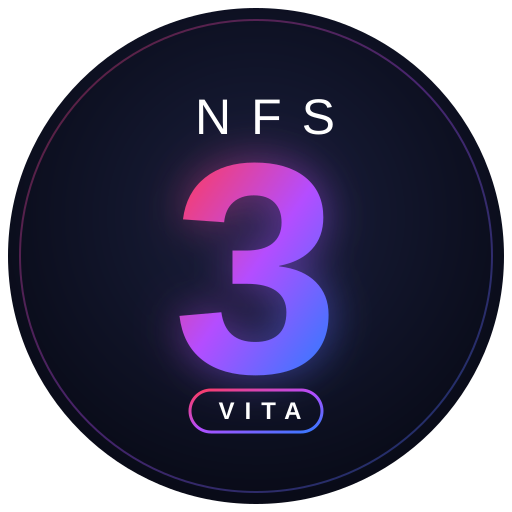

<p align="center"></p>

# NFS3VITA — Need for Speed III: Hot Pursuit on PS Vita

A PlayStation Vita port of the [nfs-recompiled](https://github.com/motor-dev/nfs-recompiled)
static recompilation of *Need for Speed III: Hot Pursuit* (Win32, 1998). The recompiled game
code runs on a virtual x86 CPU; this repository replaces the SDL3/OpenGL runtime with a native
Vita backend: libgxm rendering, SceAudioOut audio, SceCtrl input and SceKernel threads.

## Installing

The release VPK is built from the `nfs3.exe` of the [Modern Patch 1.6.1](https://gamebanana.com/mods/34590) by
natko: races run natively at 960x544 with the patch's 16:9 HUD, in-race menus and field-of-view options. The game
data is not included; you need your own copy of the game and the Modern Patch 1.6.1 archive.

1. Install `NFS3VITA.vpk` from the releases page with VitaShell.
2. Copy the `fedata` and `gamedata` folders of your game (CD or installed game) to `ux0:data/nfs3vita/`.
3. From the Modern Patch 1.6.1 archive, copy `nfs3.ini` and the `drivers`, `fedata` and `gamedata` folders to
   `ux0:data/nfs3vita/`, overwriting the files from step 2.
4. Start the game. Cross skips the intro movies.

Races start at 960x544. The 640x480 frontend menus and the loading screens are stretched to the full screen.
Optional settings go in `ux0:data/nfs3vita/nfs3vita.cfg`, one `key=value` per line:

| key | effect |
|---|---|
| `stretch=0` | menus and loading screens in 4:3 with side bars |
| `resolution=WIDTHxHEIGHT` | another race resolution, for example `1024x768` (stretched to the screen, or 4:3 with side bars with `stretch=0`) |

## Building (optional)

Only needed to build the VPK yourself. The generated recompilation (`src/nfs3hp/disassembly/`, ~85 MB) and any
game binary or data are not tracked; the build generates the code from your own copy of the game files. Only the
exact file versions listed in `tools/recompiler/generate.py` are accepted (their SHA-256 is checked).

### With the Modern Patch 1.6.1

You need:

- the Modern Patch 1.6.1, extracted (its `nfs3.exe` and data files);
- from the original game: `voodoo2a.dll` and `softtria.dll` (the patch's own drivers use Glide 3, which the port
  does not have), the `fedata` and `gamedata` folders (CD or installed game);
- `eacsnd.dll` from either.

Steps (PowerShell, after setting up the build environment below):

```powershell
# 1. one folder with the four binaries
mkdir binaries
copy <patch>\nfs3.exe, <patch>\eacsnd.dll, <game>\voodoo2a.dll, <game>\softtria.dll binaries
# 2. recompile and build
tools/generate.ps1 -Binaries binaries
tools/build.ps1                       # -> build-release/NFS3VITA.vpk
# 3. game data plus the patch's data files in one folder
tools/stage-data.ps1 -Game <game> -ModernPatch <patch> -Out vita-data
```

Install `build-release/NFS3VITA.vpk` with VitaShell and copy the contents of `vita-data` to `ux0:data/nfs3vita/`.

### With the original nfs3.exe

The original `nfs3.exe` still builds: races then render in 4:3 (up to 1024x768) with the port's own widescreen world
view (Hor+) and the original 4:3 HUD. Copy the game's `fedata` and `gamedata` folders to `ux0:data/nfs3vita/`.

### Build environment

Requirements: [VitaSDK](https://vitasdk.org) (with `VITASDK` set), CMake 3.16+, Ninja and Python 3 (for the
recompiler). The shaders ship prebuilt in `shaders/gxp/`; the official PSP2 SDK (`host_tools/bin/psp2cgc`) is only
needed to change them.

With PowerShell (Windows PowerShell 5.1 or PowerShell 7):

```powershell
tools/generate.ps1 -Binaries <dir>   # recompiles nfs3.exe + its DLLs with tools/recompiler
tools/build.ps1            # -> build-release/NFS3VITA.vpk; rebuilds only what changed
```

`tools/generate.ps1` needs Python 3 with `pip install -r tools/recompiler/requirements.txt` and a directory
holding `nfs3.exe`, `eacsnd.dll`, `softtria.dll` and `voodoo2a.dll` (their SHA-256 is checked; the upstream
repository's `nfs3hp/` folder has the original ones).

Or with CMake directly:

```sh
cmake -S . -B build-release -G Ninja -DCMAKE_TOOLCHAIN_FILE="$VITASDK/share/vita.toolchain.cmake" -DCMAKE_BUILD_TYPE=Release
cmake --build build-release
```

A full build compiles ~85 MB of generated C++. It only recurs when the generated code changes or a header it
includes changes (for example `include/x86.h`, `cpu.h`, `fpu.h`, `lib/winapp.h`); `tools/generate.ps1` rewrites only
the generated files whose content changed. Other changes rebuild a few files.

## Credits

- [nfs-recompiled](https://github.com/motor-dev/nfs-recompiled) by motor-dev: the static recompilation of the game,
  its virtual x86 CPU and Win32 runtime that this port is based on.
- [Grarak](https://github.com/Grarak): [psp2-tooling](https://github.com/Grarak/psp2-tooling), used to profile the
  port on hardware, and [mh3-wii](https://github.com/Grarak/mh3-wii), a statically recompiled game running at full
  speed that set the performance goal for this port.
- [Modern Patch](https://gamebanana.com/mods/34590) by natko: widescreen HUD, menus and fixes of the release build.

## Layout

```
cmake/          shader compilation, embedding, options
include/        virtual x86 CPU (cpu/fpu/mmx), lib/ runtime headers, winapi/ shim headers, platform/
shaders/        Cg programs; gxp/ holds their psp2cgc binaries
src/lib/        runtime: guest memory, threads, Win32 shims, Glide and DirectDraw presentation
src/platform/   Vita backend: gxm device and render thread, audio, input, sync, logging
src/nfs3hp/     entry point, game hooks, native/ hand-written replacements (+ generated disassembly/)
tools/          recompiler, generate, build, data staging and environment scripts
```
