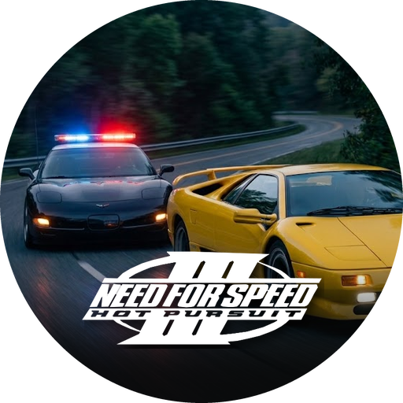

<a id="readme-top"></a>

<div align="center">



<h3 align="center">NFS3VITA 1.0</h3>

<p align="center">
  <b>Need for Speed III: Hot Pursuit, on the PS Vita</b>
  <br />
  <br />
  A port of Need for Speed III: Hot Pursuit (1998) to the PS Vita,
  <br />
  built on the <a href="https://github.com/motor-dev/nfs-recompiled">nfs-recompiled</a> static recompilation with a native sceGxm backend.
  <br />
  <br />
  <a href="../../releases"><b>Download the latest build »</b></a>
  <br />
  <br />
  <a href="#setup-for-players">Setup</a>
  &nbsp;·&nbsp;
  <a href="#controls">Controls</a>
  &nbsp;·&nbsp;
  <a href="../../issues">Report Bug</a>
</p>

[![build][build-shield]][build-url]&nbsp;[![release][release-shield]][release-url]&nbsp;[![downloads][downloads-shield]][downloads-url]&nbsp;[![issues][issues-shield]][issues-url]&nbsp;[![last commit][commit-shield]][commit-url]

[![platform][platform-shield]][platform-url]&nbsp;[![resolution][resolution-shield]][resolution-url]&nbsp;[![renderer][renderer-shield]][renderer-url]&nbsp;[![patch][patch-shield]][patch-url]&nbsp;[![base][base-shield]][base-url]&nbsp;[![license][license-shield]][license-url]

</div>

<details>
  <summary>Table of Contents</summary>
  <ol>
    <li><a href="#setup-for-players">Setup (for players)</a></li>
    <li>
      <a href="#controls">Controls</a>
      <ul>
        <li><a href="#race">Race</a></li>
        <li><a href="#menus">Menus</a></li>
      </ul>
    </li>
    <li><a href="#settings">Settings</a></li>
    <li><a href="#known-issues">Known issues</a></li>
    <li><a href="#build-for-developers">Build (for developers)</a></li>
    <li><a href="#credits">Credits</a></li>
    <li><a href="#license">License</a></li>
  </ol>
</details>

## Setup (for players)

You need your own copy of Need for Speed III: Hot Pursuit (PC) and the
[Modern Patch 1.6.1](https://gamebanana.com/mods/34590) archive by natko. The release build is made from the patch's
`nfs3.exe`, so races run natively at 960x544 with its 16:9 HUD, in-race menus and field-of-view options.

- Install `NFS3VITA.vpk` from [Releases](../../releases) with VitaShell.
- Copy the `fedata` and `gamedata` folders of your game (CD or installed game) to `ux0:data/nfs3vita/`.
- From the Modern Patch 1.6.1 archive, copy `nfs3.ini` and the `drivers`, `fedata` and `gamedata` folders to
  `ux0:data/nfs3vita/`, overwriting the files from the previous step.
- Launch from the LiveArea.

The 640x480 frontend menus and the loading screens are stretched to the full screen; see [Settings](#settings) to
turn that off.

<p align="right">(<a href="#readme-top">back to top</a>)</p>

## Controls

### Race

| Button | Action |
|:--:|--------|
|  | Accelerate |
|  | Brake / reverse |
|  Left stick | Steer (analog) |
|   | Steer, full lock |
|   | Shift up / down (manual gearbox) |
|  | Handbrake |
|  | Change camera view |
|  | Horn (siren when playing cop) |
|  (hold) | Look behind |
|  Right stick left | Reset car |
|  Right stick up | Headlights on / off |
|  Right stick down | Spike strip (cop) |
|  Right stick right | Free, bindable in the Controls menu |
|  | Map on / off |
|  | Pause |

The pad buttons are the game's own joystick bindings, so they can be changed in Options → Controllers. Pause, map
and look behind are fixed keyboard keys in the game.

### Menus

| Button | Action |
|:--:|--------|
|  Left stick / D-pad | Move the selection |
|   | Select (Enter) |
|   | Back (Escape) |
|    | Space |

Text fields (player name) open the on-screen keyboard; Enter confirms, Escape cancels.

<p align="right">(<a href="#readme-top">back to top</a>)</p>

## Settings

Optional settings go in `ux0:data/nfs3vita/nfs3vita.cfg`, one `key=value` per line.

| Key | Default | What it does |
|------|---------|--------------|
| `stretch` | `1` (`0` in a build from the original `nfs3.exe`) | `0` = menus and loading screens in 4:3 with side bars; `1` stretches them (and the race of a build from the original `nfs3.exe`) |
| `resolution` | `960x544` | Another race resolution, for example `1024x768` (stretched, or 4:3 with side bars with `stretch=0`) |

<p align="right">(<a href="#readme-top">back to top</a>)</p>

## Known issues

- Fog is not drawn: the game's THRASH fog tables are skipped.
- Options → Graphics → Screen Size cannot be selected with the pad; it lists only 960x544, use `resolution` instead.
- Split screen has no pad for the second player.

<p align="right">(<a href="#readme-top">back to top</a>)</p>

## Build (for developers)

Only needed to build the VPK yourself. Needs [VitaSDK](https://vitasdk.org) (with `VITASDK` set), CMake 3.16+,
Ninja, Python 3 and PowerShell (Windows PowerShell 5.1 or PowerShell 7). The scripts check for these and say what is
missing; the recompiler's Python package (capstone) is installed automatically.

The generated recompilation (`src/nfs3hp/disassembly/`, ~85 MB) and any game binary or data are not tracked: the build
generates the code from your own game files. Only the exact versions listed in `tools/recompiler/generate.py` are
accepted (their SHA-256 is checked).

With the Modern Patch 1.6.1 you need its `nfs3.exe`, the original game's `voodoo2a.dll` and `softtria.dll` (the
patch's own drivers use Glide 3, which the port does not have), and `eacsnd.dll` from either.

```powershell
mkdir binaries
copy <patch>\nfs3.exe, <patch>\eacsnd.dll, <game>\voodoo2a.dll, <game>\softtria.dll binaries
tools/generate.ps1 -Binaries binaries      # recompile the binaries into src/nfs3hp/disassembly
tools/build.ps1                            # -> build-release/NFS3VITA.vpk; rebuilds only what changed
tools/stage-data.ps1 -Game <game> -ModernPatch <patch> -Out vita-data   # -> contents of ux0:data/nfs3vita/
```

`tools/stage-data.ps1` copies only the patch files the port reads; copying the whole folders as in
[Setup](#setup-for-players) gives the same result.

The original `nfs3.exe` (the upstream repository's `nfs3hp/` folder has the accepted version) still builds: races
then render in 4:3 (up to 1024x768) with the port's own widescreen world view and the original 4:3 HUD.

A full build compiles ~85 MB of generated C++. It only recurs when the generated code or a header it includes
changes; `tools/generate.ps1` rewrites only the generated files whose content changed. The shaders ship prebuilt in
`shaders/gxp/`; the official PSP2 SDK (`host_tools/bin/psp2cgc`) is only needed to change them.

| Path | Contents |
|------|----------|
| `include/` | virtual x86 CPU (cpu/fpu/mmx), `lib/` runtime headers, `winapi/` shim headers, `platform/` |
| `src/lib/` | runtime: guest memory, threads, Win32 shims, Glide and DirectDraw presentation |
| `src/platform/` | Vita backend: gxm device and render thread, audio, input, sync, logging |
| `src/nfs3hp/` | entry point, game hooks, `native/` hand-written replacements (+ generated `disassembly/`) |
| `shaders/` | Cg programs; `gxp/` holds their compiled binaries |
| `tools/` | recompiler, generate, build, data staging and environment scripts |

<p align="right">(<a href="#readme-top">back to top</a>)</p>

## Credits

- [nfs-recompiled](https://github.com/motor-dev/nfs-recompiled) (motor-dev) — the static recompilation of the game,
  its virtual x86 CPU and Win32 runtime that this port builds on.
- [Modern Patch](https://gamebanana.com/mods/34590) (natko) — the widescreen HUD, menus and fixes of the release build.
- [Grarak](https://github.com/Grarak) — [psp2-tooling](https://github.com/Grarak/psp2-tooling), used to profile the
  port on hardware, and [mh3-wii](https://github.com/Grarak/mh3-wii), a statically recompiled game running at full
  speed that set the performance goal for this port.
- Electronic Arts — the original *Need for Speed III: Hot Pursuit*.

<p align="right">(<a href="#readme-top">back to top</a>)</p>

## License

The port's own code is MIT (see [LICENSE](LICENSE)). Code that comes from nfs-recompiled keeps its author's
copyright — that repository has no license yet — and other third-party parts keep their own licenses; see
[THIRD_PARTY.md](THIRD_PARTY.md). The game and the Modern Patch are not part of this repository.

Unofficial, non-commercial fan port — not affiliated with or endorsed by Electronic Arts. *Need for Speed* is a
trademark of Electronic Arts; you must own a legal copy to play.

<p align="right">(<a href="#readme-top">back to top</a>)</p>

<!-- BADGES -->

[build-shield]: https://img.shields.io/github/actions/workflow/status/NDRWhun/NFS3VITA/build.yml?branch=main&label=build&style=for-the-badge&labelColor=1a1f3d&logo=githubactions&logoColor=white
[build-url]: ../../actions/workflows/build.yml
[release-shield]: https://img.shields.io/github/v/release/NDRWhun/NFS3VITA?label=release&style=for-the-badge&labelColor=1a1f3d&color=ff3b5c&logo=github&logoColor=white
[release-url]: ../../releases
[downloads-shield]: https://img.shields.io/github/downloads/NDRWhun/NFS3VITA/total?label=downloads&style=for-the-badge&labelColor=1a1f3d&color=b44dff
[downloads-url]: ../../releases
[issues-shield]: https://img.shields.io/github/issues/NDRWhun/NFS3VITA?label=issues&style=for-the-badge&labelColor=1a1f3d&color=2f7bff&logo=github&logoColor=white
[issues-url]: ../../issues
[commit-shield]: https://img.shields.io/github/last-commit/NDRWhun/NFS3VITA?label=updated&style=for-the-badge&labelColor=1a1f3d&color=ff3b5c
[commit-url]: ../../commits/main
[platform-shield]: https://img.shields.io/badge/PS%20Vita-native-2f7bff?style=for-the-badge&labelColor=1a1f3d&logo=playstation&logoColor=white
[platform-url]: https://vitasdk.org
[resolution-shield]: https://img.shields.io/badge/960x544-widescreen-b44dff?style=for-the-badge&labelColor=1a1f3d
[resolution-url]: #settings
[renderer-shield]: https://img.shields.io/badge/renderer-sceGxm-ff3b5c?style=for-the-badge&labelColor=1a1f3d
[renderer-url]: src/platform/gxm
[patch-shield]: https://img.shields.io/badge/Modern%20Patch-1.6.1-b44dff?style=for-the-badge&labelColor=1a1f3d
[patch-url]: https://gamebanana.com/mods/34590
[base-shield]: https://img.shields.io/badge/base-nfs--recompiled-2f7bff?style=for-the-badge&labelColor=1a1f3d
[base-url]: https://github.com/motor-dev/nfs-recompiled
[license-shield]: https://img.shields.io/badge/license-MIT-ff3b5c?style=for-the-badge&labelColor=1a1f3d
[license-url]: LICENSE
